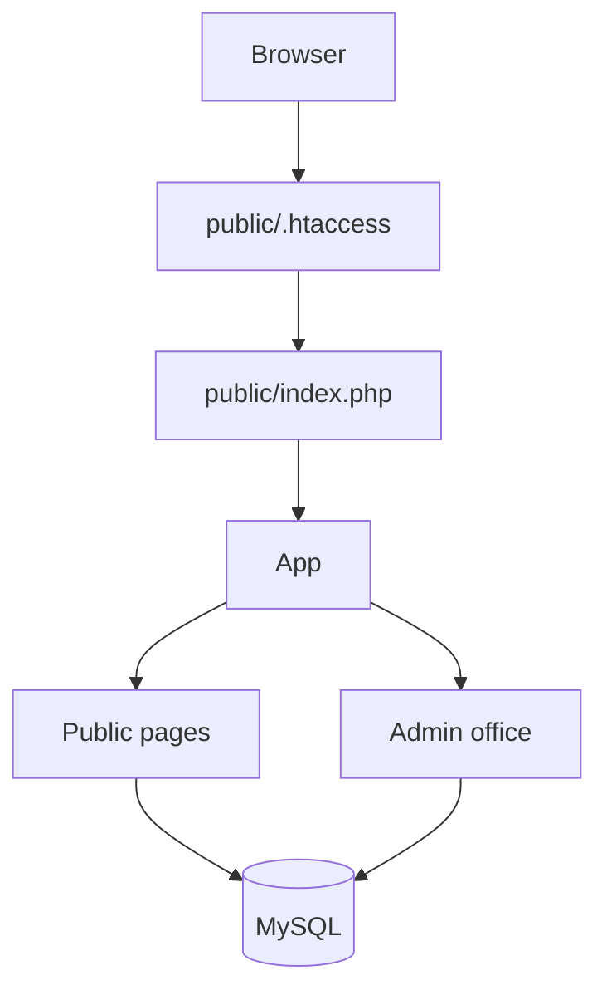
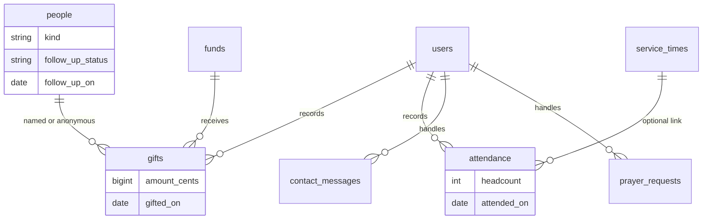
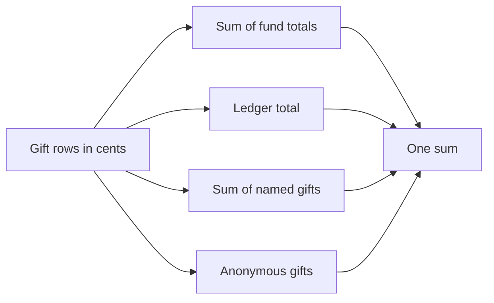

# Olive Branch Ministries Inc.

Public website and church office for Olive Branch Ministries Inc. in Moultrie, Georgia. The public pages use confirmed facts only. The office at `/admin` keeps events, service times, messages, prayer requests, people, giving, and attendance.

[](https://github.com/Awkward8787/olivebranchministry/actions/workflows/ci.yml)


Hostinger shared hosting can run it: PHP 8.1 or newer and MySQL or MariaDB. The server does not need Node. Composer is used to install PHPUnit on a development machine. The site itself loads classes from `src/` without Composer.

## Request flow



A request that is not a real file is rewritten to `public/index.php`. Public pages read service times and published events. Contact and prayer forms write rows after a CSRF check, a honeypot, and a rate limit. `/admin` requires a signed-in user. Funds and users are limited to the administrator role.

## Data model



Money is `amount_cents`, an integer. Gift dates and attendance dates are calendar dates. The application reads them in `America/New_York`.

## Giving reconciliation



For any inclusive date range:

- the sum of per-fund totals
- the ledger total
- the sum of named gifts plus anonymous gifts

are the same number. Anonymous gifts stay in the ledger and in their fund. They are not printed on a person's statement. A church statement includes only funds whose receiving organization is the church. The Hub fund is unconfirmed, so its gifts stay on the ledger and are left off the church statement. The office refuses to show a ledger if the identity fails.

## Money, dates, and attendance

Amounts are parsed from the typed text as integer cents. The code does not multiply a float by 100. `1.15` is 115 cents. Display formatting happens only when a page is drawn.

Date ranges include both ends. "This month", "this quarter", and "this year" use the wall clock in `America/New_York`, so 12:30 a.m. Eastern on January 1 is January even when UTC is still December. Weeks run Sunday through Saturday. A week that crosses the range counts only rows inside the range.

The attendance average is the mean of recorded headcounts in the range. It is not divided by the number of calendar weeks. A headcount of zero counts. Rounding is half up to one decimal, in integer tenths: 1.25 becomes 1.3, and 2/3 becomes 0.7. If there are no records the average is empty. The page says "No attendance recorded" and does not divide by zero.

## Local setup

Requirements: PHP 8.1+ with `pdo_mysql` and `mbstring`, Composer, and MySQL or MariaDB.

```bash
composer install
cp config.example.php config.php
```

Create an empty database, put its name, user, and password only in `config.php`, and set `app.env` to `local` and `app.url` to `http://127.0.0.1:8080`.

```bash
mysql -u olive_branch -p olive_branch < schema.sql
read -rs ADMIN_PASSWORD && export ADMIN_PASSWORD && ADMIN_EMAIL='you@example.com' php bin/seed-admin.php; unset ADMIN_PASSWORD
php -S 127.0.0.1:8080 -t public bin/php-server-router.php
```

`schema.sql` creates tables and inserts the published service times and the five funds. It does not insert people, gifts, messages, or a password.

Demo rows are optional and local. They are marked `DEMO` and are refused when `app.env` is `production` or when `ALLOW_DEMO_SEED` is not `1`.

```bash
ALLOW_DEMO_SEED=1 php bin/seed-demo.php
```

Do not point a public site at a database that still contains those rows.

Tests:

```bash
vendor/bin/phpunit
php bin/a11y-check.php
```

The responsive banner and portrait in `public/assets/img` are already committed. `bin/optimize-images.sh` rebuilds them from `assets/brand/` when ImageMagick, `cwebp`, and `avifenc` are installed. The logo files are resized only. They are not cropped or retitled.

## Deploy on Hostinger

1. In hPanel, create a MySQL database and user. Note the host, database name, user, and password.
2. Open phpMyAdmin and import `schema.sql` into that empty database.
3. Set the domain document root to the `public` directory. Upload the project so `config.php` sits beside `public`, not inside it:

```text
home/
  config.php
  src/
  templates/
  bin/
  schema.sql
  public/          <- document root
    index.php
    .htaccess
    assets/
```

   If the plan only serves `public_html`, upload the contents of `public/` into `public_html` and upload `src/`, `templates/`, `bin/`, and `config.php` into the home directory next to `public_html`. `index.php` loads `src/` from the parent of the document root.

4. Copy `config.example.php` to `config.php` on the server. Set the database credentials, `app.env` to `production`, and `app.url` to the https origin with no trailing slash, for example `https://example.org`. Leave `giving.online_url`, `mail.notify_to`, and `statement.ein` empty until the church supplies them. Do not put The Hub's EIN in `statement.ein`.
5. In hPanel, set PHP to 8.1 or newer and turn on Force HTTPS.
6. From the Hostinger terminal, in the directory that contains `bin/`:

```bash
read -rs ADMIN_PASSWORD && export ADMIN_PASSWORD && ADMIN_EMAIL='office@example.com' php bin/seed-admin.php; unset ADMIN_PASSWORD
```

   The password is an environment variable, not a committed file and not a script argument. `read -rs` keeps it out of shell history. Use 12 to 72 characters. Running the command again prints `Account exists; nothing changed` and does not reset the password or change the role. `--reset-password` resets the password and ends that account's other sessions. `--make-admin` sets the role to administrator and does not change the password unless `--reset-password` is also present. Do not run `bin/seed-demo.php` on the public database.

   A database created from the first `schema.sql` can be upgraded once with `sql/migrate-review.sql`. Do not import `schema.sql` again into a live database.
7. Open `/` and `/admin/login`. Sign in, then change nothing in `schema.sql` on later deploys. Importing it again into a live database will fail because the tables already exist, which is intentional.

`config.php` is gitignored. The root `.htaccess` denies `src/`, `templates/`, `bin/`, `tests/`, `docs/`, and `config.php` if the document root is ever pointed at the project folder instead of `public/`.

## Office notes

Staff and administrators share the inbox, directory, giving ledger, attendance, events, and service times. Prayer requests are visible only after sign-in. The notification email says a request is waiting and links to the inbox. It does not include the request. Handled messages and prayer requests are deleted after `privacy.handled_days` (90 by default). The inbox pages older rows instead of stopping at 200. Administrators also manage funds and users. The last administrator cannot be demoted or disabled. A password change ends that account's other sessions. There is no email password reset.

Recorded gifts are append-only. Staff and administrators post a void or an adjustment with a reason. The audit log stores who, when, and why. A year stays open to staff through January 31 of the next year. After that, only an administrator can post a void or an adjustment. New gifts use active funds. The ledger and the statement use the net of the original amount, adjustments, and voids.

Year-end statements are printable HTML. Use the browser's print dialog and choose Save as PDF. The church name, address, phone, and email are printed, with the issue date. A goods or services note requires a good-faith estimate in cents, and the statement prints that estimate. The intangible-religious-benefits sentence is printed by default. A church EIN is printed only when `statement.ein` is set to a value other than The Hub's EIN. Set `mail.from` to an address on the site's own domain before notifications are sent. Leave it blank to skip mail. Do not use the church Gmail address as `From`.

Set `expose_php` to `Off` in the host PHP settings. The application removes `X-Powered-By` on each response. `Strict-Transport-Security` is sent when the request is HTTPS.

What the church still needs to confirm is listed in [docs/CHURCH-TODO.md](docs/CHURCH-TODO.md).
